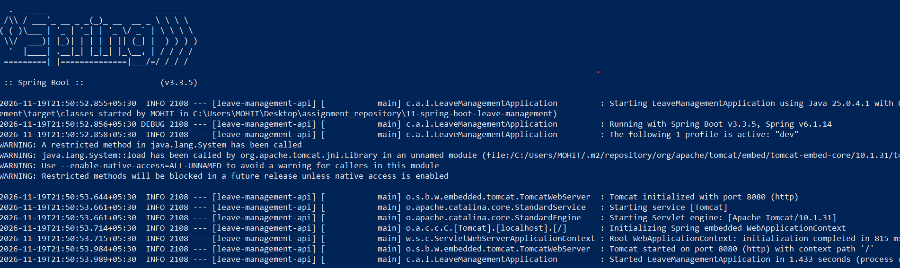
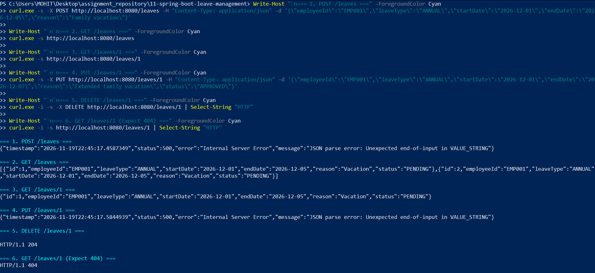
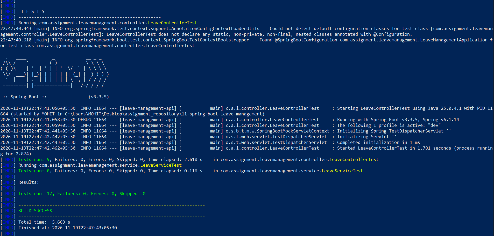

# Leave Management API

## Project Overview
A Spring Boot REST API for managing employee leave requests. The application follows a clean layered architecture (`Controller -> Service -> Repository`) using constructor-based dependency injection, Jakarta Bean Validation, global exception handling, and in-memory storage (`ConcurrentHashMap`).

## Build and Run Instructions

### Prerequisites
- Java 17+ (or 21+)
- Maven 3.8+

### Build
Navigate to this directory and build the project:
```bash
mvn clean package
```

### Run
Run the application with the `dev` profile (active by default):
```bash
mvn spring-boot:run
```
The server will start at `http://localhost:8080`.

## API Endpoint Summary

Base URL: `http://localhost:8080/leaves`

| Method | Endpoint | Description | Status Codes |
|---|---|---|---|
| `GET` | `/leaves` | Retrieve all leave requests | 200 OK |
| `GET` | `/leaves/{id}` | Retrieve a leave request by ID | 200 OK, 404 Not Found |
| `POST` | `/leaves` | Create a new leave request | 201 Created, 400 Bad Request |
| `PUT` | `/leaves/{id}` | Update an existing leave request | 200 OK, 400 Bad Request, 404 Not Found |
| `DELETE` | `/leaves/{id}` | Delete a leave request | 204 No Content, 404 Not Found |

### Sample JSON Request Body (POST / PUT)
```json
{
  "employeeId": "EMP001",
  "leaveType": "ANNUAL",
  "startDate": "2026-12-01",
  "endDate": "2026-12-05",
  "reason": "Annual vacation",
  "status": "PENDING"
}
```

### Sample curl Commands

> **Note for Windows PowerShell Users**: In PowerShell, `curl` is an alias for `Invoke-WebRequest`. Use **`curl.exe`** (or `Invoke-RestMethod`) instead of `curl`.

#### 1. Create a Leave Request (POST)
**Linux / macOS / Git Bash**:
```bash
curl -X POST http://localhost:8080/leaves \
  -H "Content-Type: application/json" \
  -d '{"employeeId":"EMP001","leaveType":"ANNUAL","startDate":"2026-12-01","endDate":"2026-12-05","reason":"Annual vacation"}'
```
**Windows PowerShell**:
```powershell
curl.exe -X POST http://localhost:8080/leaves -H "Content-Type: application/json" -d '{\"employeeId\":\"EMP001\",\"leaveType\":\"ANNUAL\",\"startDate\":\"2026-12-01\",\"endDate\":\"2026-12-05\",\"reason\":\"Annual vacation\"}'
```

#### 2. Retrieve All Leave Requests (GET)
```bash
curl.exe http://localhost:8080/leaves
```

#### 3. Retrieve Leave Request by ID (GET)
```bash
curl.exe http://localhost:8080/leaves/1
```

#### 4. Update Leave Request (PUT)
**Windows PowerShell**:
```powershell
curl.exe -X PUT http://localhost:8080/leaves/1 -H "Content-Type: application/json" -d '{\"employeeId\":\"EMP001\",\"leaveType\":\"SICK\",\"startDate\":\"2026-12-01\",\"endDate\":\"2026-12-03\",\"reason\":\"Flu recovery\",\"status\":\"APPROVED\"}'
```

#### 5. Delete Leave Request (DELETE)
```bash
curl.exe -X DELETE http://localhost:8080/leaves/1
```

## Testing Instructions

Execute unit and controller tests:
```bash
mvn test
```
- **Service Tests**: `LeaveServiceTest` tests business logic and exceptions using JUnit 5 and Mockito.
- **Controller Tests**: `LeaveControllerTest` tests REST endpoints and Bean Validation using MockMvc.

## Screenshots

### 1. Successful Application Startup


### 2. Successful Execution of the REST APIs


### 3. Successful Execution of the Test Suite

