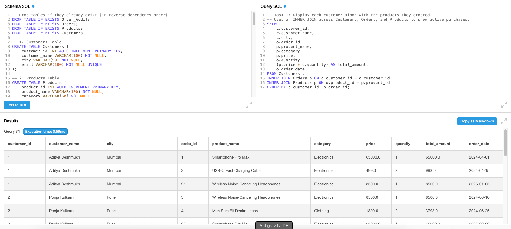
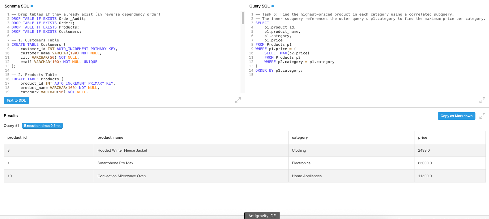
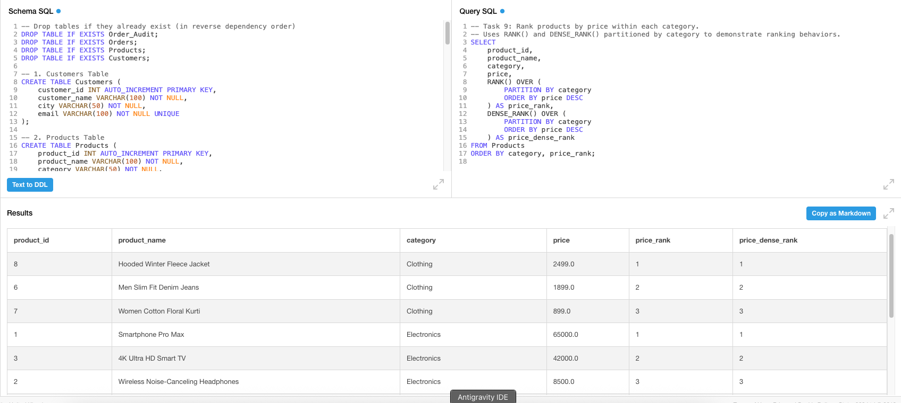
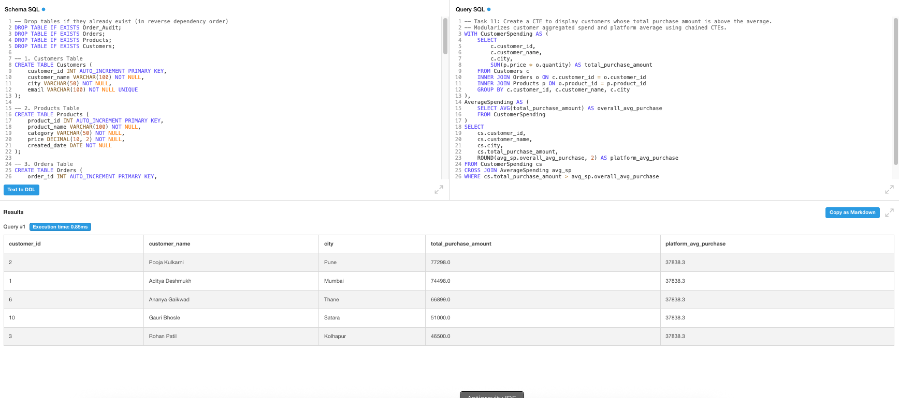
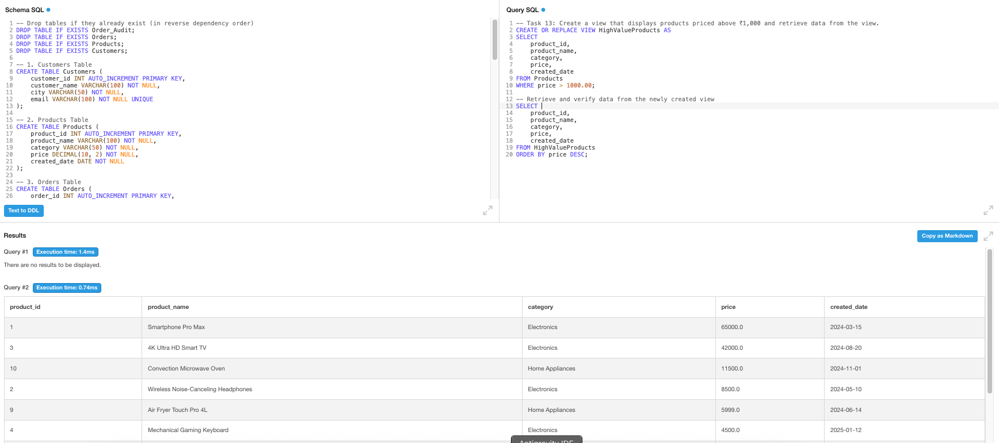
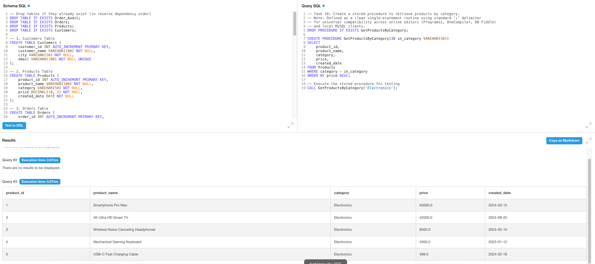
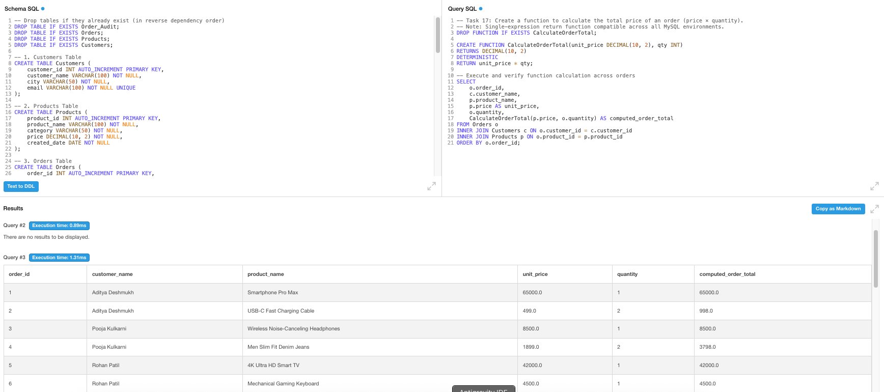
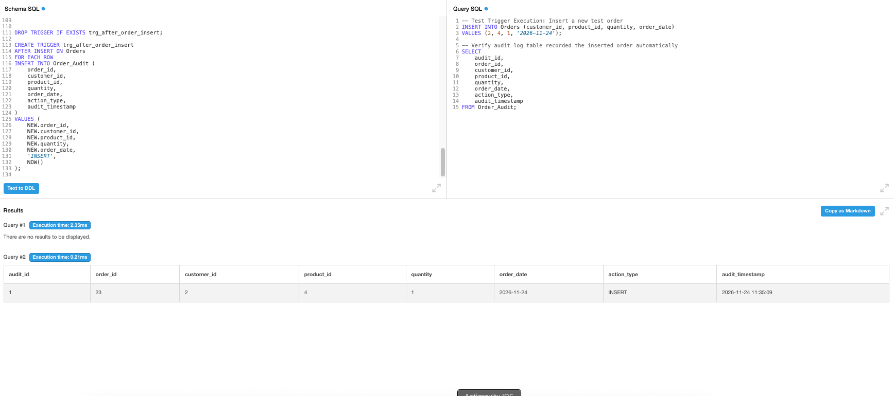
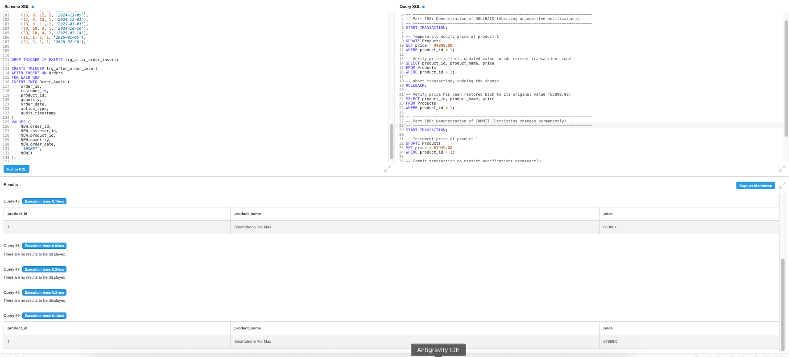
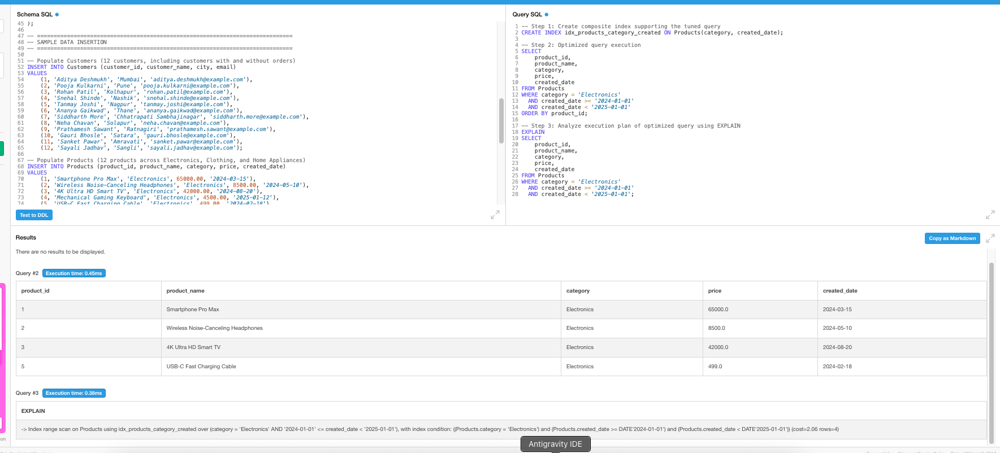

# SQL (Advanced) Assignment - Online Shopping Platform

## Assignment Overview
This project delivers the database modernization solution for an online shopping platform managing customer records, product inventories, and customer orders. It demonstrates proficiency across 20 advanced SQL tasks covering relational joins, subqueries, set operations, analytical window functions, Common Table Expressions (CTEs), database views, B-Tree indexing, stored procedures, deterministic user-defined functions, ACID transaction management, automated triggers, and query performance tuning.

---

## Database Schema

### 1. Customers Table
| Column | Data Type | Constraints | Description |
| :--- | :--- | :--- | :--- |
| `customer_id` | INT | PRIMARY KEY, AUTO_INCREMENT | Unique identifier for customer |
| `customer_name` | VARCHAR(100) | NOT NULL | Customer full name |
| `city` | VARCHAR(50) | NOT NULL | Customer residential city |
| `email` | VARCHAR(100) | NOT NULL, UNIQUE | Customer email address |

### 2. Products Table
| Column | Data Type | Constraints | Description |
| :--- | :--- | :--- | :--- |
| `product_id` | INT | PRIMARY KEY, AUTO_INCREMENT | Unique identifier for product |
| `product_name` | VARCHAR(100) | NOT NULL | Name / title of product |
| `category` | VARCHAR(50) | NOT NULL | Product category (e.g., Electronics, Clothing) |
| `price` | DECIMAL(10,2) | NOT NULL | Unit price in INR (₹) |
| `created_date` | DATE | NOT NULL | Date product was added to catalog |

### 3. Orders Table
| Column | Data Type | Constraints | Description |
| :--- | :--- | :--- | :--- |
| `order_id` | INT | PRIMARY KEY, AUTO_INCREMENT | Unique order identifier |
| `customer_id` | INT | FOREIGN KEY (`Customers.customer_id`) | References `Customers(customer_id)` |
| `product_id` | INT | FOREIGN KEY (`Products.product_id`) | References `Products(product_id)` |
| `quantity` | INT | NOT NULL | Units purchased |
| `order_date` | DATE | NOT NULL | Date order was placed |

*Entity Relationships:*
* `Customers` (1) to `Orders` (N) via `customer_id` (`ON DELETE CASCADE`)
* `Products` (1) to `Orders` (N) via `product_id` (`ON DELETE RESTRICT`)

### 4. Order_Audit Table (Task 19)
| Column | Data Type | Constraints | Description |
| :--- | :--- | :--- | :--- |
| `audit_id` | INT | PRIMARY KEY, AUTO_INCREMENT | Unique audit entry identifier |
| `order_id` | INT | NOT NULL | Identifier of inserted order |
| `customer_id` | INT | NOT NULL | Customer who placed order |
| `product_id` | INT | NOT NULL | Product purchased |
| `quantity` | INT | NOT NULL | Quantity ordered |
| `order_date` | DATE | NOT NULL | Original order date |
| `action_type` | VARCHAR(50) | DEFAULT 'INSERT' | DML operation type |
| `audit_timestamp`| TIMESTAMP | DEFAULT CURRENT_TIMESTAMP | Automatic timestamp of audit capture |

---

## Steps to Execute the SQL Script

### Option 1: Using Local MySQL (CLI or MySQL Workbench) — Recommended
1. Launch your terminal client or **MySQL Workbench** and connect to your local MySQL instance:
   ```bash
   mysql -u root -p
   ```
2. Create and select the database:
   ```sql
   CREATE DATABASE IF NOT EXISTS online_shopping_db;
   USE online_shopping_db;
   ```
3. Load and execute the complete script [`online-shopping-platform.sql`](online-shopping-platform.sql):
   ```sql
   SOURCE 13-sql-advanced-assignment/online-shopping-platform.sql;
   ```

### Option 2: Using Online SQL Compilers (DB Fiddle / OneCompiler / Programiz)
1. Open [DB Fiddle](https://www.db-fiddle.com/) (select **MySQL 8.0**) or [OneCompiler](https://onecompiler.com/mysql).
2. Paste the contents of [`online-shopping-platform.sql`](online-shopping-platform.sql) into the schema/query panel.
3. Click **Run** to execute the script and inspect tabular outputs.

---

## Summary of Implemented Advanced SQL Concepts

| Section | Topic | Implemented Tasks & Key Concepts |
| :--- | :--- | :--- |
| **Section 1** | **Advanced Joins** | `INNER JOIN` across 3 tables (Task 1), Cartesian product with `CROSS JOIN` (Task 2), `LEFT JOIN` preserving unplaced customer orders with `NULL` (Task 3). |
| **Section 2** | **Subqueries** | Scalar subquery filtering above `AVG(price)` (Task 4), `HAVING` subquery comparing customer aggregate spend against overall average (Task 5), correlated subquery finding maximum price per category (Task 6). |
| **Section 3** | **Set Operations** | `UNION` combining distinct category records (Task 7), MySQL alternative for `INTERSECT` using `INNER JOIN`, and alternative for `EXCEPT` using `LEFT JOIN ... WHERE ... IS NULL` (Task 8). |
| **Section 4** | **Window Functions** | Analytical ranking with `RANK()` and `DENSE_RANK()` partitioned by category (Task 9), preceding value comparison with `LAG()` and running total accumulation with `SUM() OVER (...)` (Task 10). |
| **Section 5** | **Common Table Expressions** | Multi-step modular aggregation with chained CTEs (Task 11), sequence generation from 1 to 10 using `WITH RECURSIVE` (Task 12). |
| **Section 6** | **Views** | Abstraction and security encapsulation with `CREATE OR REPLACE VIEW HighValueProducts` for items > ₹1,000 (Task 13). |
| **Section 7** | **Indexes & Query Performance** | Single-column B-Tree index creation on `category` (Task 14), execution plan inspection using `EXPLAIN` (Task 15). |
| **Section 8** | **Stored Procedures & Functions** | Parameterized stored procedure `GetProductsByCategory` with `IN` argument (Task 16), deterministic scalar function `CalculateOrderTotal(price, qty)` (Task 17). |
| **Section 9** | **Transactions** | ACID compliance demonstration illustrating `START TRANSACTION`, `ROLLBACK` for restoring uncommitted state, and `COMMIT` for persisting changes (Task 18). |
| **Section 10** | **SQL Triggers** | Automated event-driven auditing using `AFTER INSERT ON Orders` trigger inserting into `Order_Audit` (Task 19). |
| **Section 11** | **Performance Tuning** | Query optimization removing wildcard `SELECT *`, removing redundant `DISTINCT`, avoiding function evaluation on indexed columns, and introducing composite index `(category, created_date)` for sargable range seeks (Task 20). |

---

## Execution Screenshots

Verification screenshots confirming successful execution are cataloged in the [`screenshots/`](screenshots/) directory:

| Milestone / Concept | Description | Screenshot Link |
| :--- | :--- | :--- |
| **Advanced Joins** | Multi-table `INNER JOIN` displaying customers, products, and order amounts | [01-advanced-join-query.png](screenshots/01-advanced-join-query.png) |
| **Subqueries** | Correlated subquery determining highest-priced product per category | [02-subquery-execution.png](screenshots/02-subquery-execution.png) |
| **Window Functions** | `RANK()` and `DENSE_RANK()` partitioned by product category | [03-window-function.png](screenshots/03-window-function.png) |
| **CTEs** | Chained CTE evaluating high-spending customers above platform average | [04-cte-execution.png](screenshots/04-cte-execution.png) |
| **Views** | View creation and query execution on `HighValueProducts` | [05-view-execution.png](screenshots/05-view-execution.png) |
| **Stored Procedure** | Parameterized stored procedure `GetProductsByCategory` execution | [06-01-stored-procedure.png](screenshots/06-01-stored-procedure.png) |
| **Scalar Function** | User-defined deterministic function `CalculateOrderTotal` execution | [06-02-function.png](screenshots/06-02-function.png) |
| **Trigger Execution** | `AFTER INSERT` trigger capturing order insertion into `Order_Audit` | [07-trigger-execution.png](screenshots/07-trigger-execution.png) |
| **Transactions (COMMIT & ROLLBACK)** | ACID transaction rollback and commit demonstrations | [08-transaction-commit-rollback.png](screenshots/08-transaction-commit-rollback.png) |
| **EXPLAIN & Query Tuning** | `EXPLAIN` query execution plan showing index range seek on tuned query | [09-explain-query-output.png](screenshots/09-explain-query-output.png) |

### Visual Verification Previews

#### 1. Advanced Joins Query


#### 2. Correlated Subquery Execution


#### 3. Window Functions (RANK & DENSE_RANK)


#### 4. Common Table Expressions (CTE)


#### 5. Database View (HighValueProducts)


#### 6.1. Stored Procedure Execution (Task 16)


#### 6.2. User-Defined Function Execution (Task 17)


#### 7. SQL Trigger & Automated Audit Logging


#### 8. Transactions (ACID COMMIT & ROLLBACK)


#### 9. EXPLAIN Query Output & Index Tuning

